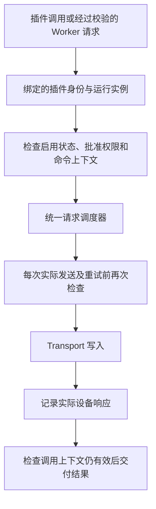

# 插件通信授权

本文定义插件安装批准、设备通信权限、运行实例失效及授权记录的保护边界。
插件公共 `readRegisters` / `writeRegisters` 参数保持不变。

## 1. Base behavior / Current behavior

| 范围     | Base behavior                                   | Current behavior                                                             |
| -------- | ----------------------------------------------- | ---------------------------------------------------------------------------- |
| 权限     | 清单声明权限，安装界面展示；通信 API 只检查会话 | 主程序记录已批准权限；每次调用、每次实际发送和重试前检查授权                 |
| 身份     | Worker 消息中的 `payload.pluginId` 选择通信 API | 激活时绑定主程序提供的 API 和插件身份；消息身份不匹配时拒绝                  |
| 写入     | 激活上下文可直接调用写入                        | 激活上下文只提供获准的读取；写入还必须处于用户触发的工具栏命令上下文         |
| 生命周期 | 已取得的 API 可继续引用会话                     | API 绑定注册对象和运行代次；禁用、卸载、失败或销毁后失效                     |
| 预览     | 提取 Manifest 的运行时可能保留                  | 预览固定使用隔离环境，不提供通信权限；提取清单后立即释放                     |
| 恢复     | 先导入源码再应用启用状态                        | 先检查启用状态及批准内容；禁用或未批准的源码不执行                           |
| Web 存储 | Worker 与应用同源                               | Worker 由不含 `allow-same-origin` 的沙箱 iframe 创建，不能访问应用 IndexedDB |

## 2. 权限与批准

Manifest 的 `permissions` 仅描述插件所需权限。用户在安装确认框中确认完整权限集合和
执行模式后，宿主才生成批准记录。插件不能通过增加清单字段自行获得授权。

| 操作       | 必须具备的权限                    | 额外条件                                 |
| ---------- | --------------------------------- | ---------------------------------------- |
| 读取寄存器 | `communication`                   | 注册对象有效、插件已启用、当前实例未失效 |
| 写入寄存器 | `communication` 与 `device-write` | 满足读取条件，且命令上下文仍有效         |

只有 `device-write` 而没有 `communication` 的声明拒绝注册。未知权限仍拒绝安装。
未授权调用返回结构化 `PLUGIN_PERMISSION_DENIED`，不读取会话信息，也不发送报文。
已授权但没有可用会话时，保留 `PLUGIN_RUNTIME_NOT_AVAILABLE`。

批准记录包含 `contentDigest` 和 `permissions`。`contentDigest` 使用 SHA-256，输入为
按对象键排序后的完整 Manifest、原始 `entrySource` 和 `executionMode`；数组顺序保留。
源码、清单或执行模式变化后，旧批准不再匹配，必须重新确认。插件 ID 相同不代表内容
相同。摘要用于检测批准内容与当前内容的差异，不是签名，也不能单独阻止存储被篡改。

首次预览结果由宿主保存，确认安装时要求源码与该预览一致。再次加载得到的 Manifest
也必须与预览相同。预览返回给界面的是副本。宿主只保留最近一次预览，较早的确认请求
不能套用较新的预览。

对应实现：[批准记录](../../../../packages/plugin-api/src/plugin-approval.ts)、
[权限规则](../../../../packages/plugin-api/src/authorization.ts)、
[安装与恢复](../../../../apps/web/src/AppHost.ts)。

## 3. 身份、实例与命令

`PluginRegistry` 为每次注册保存独立对象，并为当前运行代次保存独立标识。通信 API
捕获二者的身份。禁用、卸载、执行失败或宿主销毁先使标识失效，再执行资源释放。
同名插件重新安装或重新启用后，旧 API 不能获得新实例的授权。

同进程与隔离运行时均使用 Registry 创建的授权 API。Worker 通道在激活时绑定
`ctx.pluginId` 和 `ctx.communication`；消息中的 ID 只用于一致性校验，不用于查找
其他插件的权限。通信日志使用宿主绑定的 ID。

Worker 到宿主的事件使用 `version: 1`，宿主在分发前校验操作、地址、数量和值。
只接受明确的 `read` 或 `write`；未知操作不能被解释为写入。格式错误、运行时崩溃
或销毁会使当前实例失效，并撤销其尚未发送的请求。

`activate` 获得的 API 没有写入上下文。用户通过主程序执行 `invokeToolbarAction`
时，Registry 创建独立命令上下文；回调完成或失败后立即关闭该上下文。插件应等待
命令内的写操作完成。保存该 API 后延迟写入，或启动一个未等待的后台写任务，不能
获得永久写权限。现有隔离运行时没有工具栏动作执行入口，因此只授予获准的读取能力。
后续若开放隔离命令，必须由宿主创建同样受限的命令上下文。

异步生命周期回调修改状态前同时检查注册对象和运行代次。旧实例完成或失败，不改变
同名新实例的权限、状态或贡献点。

对应实现：[插件注册表](../../../../packages/plugin-api/src/registry.ts)、
[Web 消息桥](../../../../packages/platform-web/src/plugin-remote-runtime.ts)、
[Node 消息桥](../../../../packages/platform-node/src/plugin-remote-runtime.ts)。

## 4. 调度、撤销与迟到响应

每个插件请求带独立取消标记和宿主提供的 `beforeSend` 检查。撤销授权时标记取消，
并立即结清队列中尚未发送的取消项；其他调用方和已发送的交换继续按会话规则处理。
该检查同时覆盖内置 RTU/TCP 与 codec 的实际交换路径，且在重试时重新执行。
设备请求仍使用已有统一调度器，不增加旁路 Transport。

已经写到 Transport 的字节无法撤回。撤销后不再启动后续发送或重试，已发送操作的
实际响应继续进入原请求日志；旧调用不再获得可作为当前结果使用的成功值。旧 Worker
的响应不会被交给替换后的运行时。

对应实现：[插件通信 API](../../../../packages/application/src/plugin-communication.ts)、
[通信会话](../../../../packages/communication/src/session.ts)、
[请求调度器](../../../../packages/communication/src/request-scheduler.ts)。

## 5. 存储、恢复与平台边界

插件存储升级为 v5，新增可选 `approval`。v4 迁移保留 Manifest、源码和执行模式，
清除推定授权并将可执行插件设为禁用；纯清单插件保留原启用状态。用户通过插件列表的 `Review permissions` 重新预览并确认，
不需要先删除保留的源码。缺少批准或批准内容不匹配时，不能导入可执行源码。
v1/v2/v3 沿用既有的空插件列表迁移；未知版本拒绝读取，不作为空列表处理。
工作区存储格式不变。跨宿主插件存储消息同步使用 v5，并保留批准字段。

启动恢复先检查禁用状态和批准摘要。禁用插件仅恢复元数据，不导入源码；显式启用时
才创建新的运行时。启用期间发生禁用、卸载或宿主销毁时，后续加载结果不能重新启用
该插件。加载失败保留原有禁用记录。关闭宿主先停止持久化订阅，再释放实例，不能把
关闭运行时保存成卸载插件。

Browser、Electron Renderer、VSCode Webview 和 Android WebView 共享 Web 运行时。
隔离插件位于沙箱 iframe 创建的 Worker 中。iframe 只允许 `allow-scripts`，禁止
`allow-same-origin`；它通过一次性传递的私有 `MessagePort` 转发消息。沙箱 CSP 只
允许应用自带的固定引导脚本和 Blob 脚本/Worker，禁止网络连接及其他资源。
引导脚本内联在沙箱文档中；主页面与沙箱 CSP 均使用其精确 SHA-256 哈希授权，
不启用 `script-src 'unsafe-inline'`。这样可支持 Electron 的 `file://` 页面，
无需让不透明来源加载本地文件。VSCode 替换资源来源时保留构建产物中的脚本哈希。
沙箱创建失败时返回加载失败，不回退到与应用同源的 Worker。控制操作等待有界；
销毁会结清等待者并释放 Worker、iframe、消息端口和宿主 Blob URL。

Electron Main 和 VSCode Extension Host 在导入 `same-process` 源码前也核对批准内容。
这些宿主仍只加载已启用且被批准的同进程插件，不因为本次授权设计开放新的 TCP
通信桥或 Node 隔离插件入口。Node Worker 的 API 桥身份检查不代表操作系统沙箱。

`same-process` 仍是用户明确选择的完全信任模式。通信 API 会执行同样的权限检查，
但不能阻止这类代码直接使用自身已有的宿主能力，也不能靠禁用收回已经取得的系统
权限。该信任边界必须继续在安装确认框中展示。

对应实现：[存储契约](../../../../packages/plugin-api/src/plugin-store.ts)、
[跨宿主载荷](../../../../packages/platform-api/src/session-payloads.ts)、
[Web 沙箱](../../../../packages/platform-web/src/plugin-sandbox-worker.ts)、
[宿主加载器](../../../../packages/platform-node/src/host-plugin-runtime.ts)。
